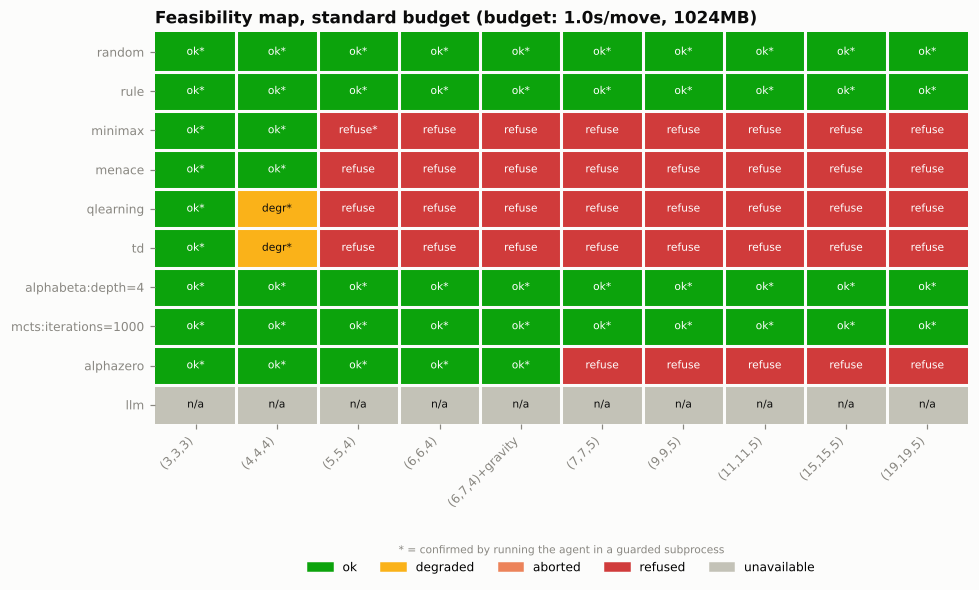
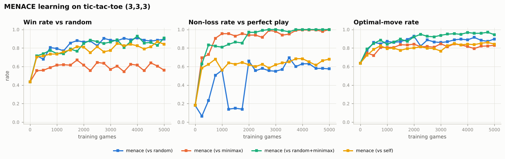
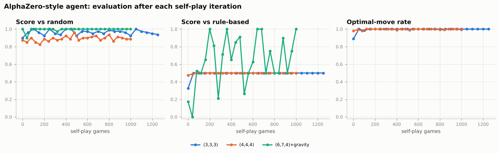

# mnk-bench

**Where does each game-playing AI fall apart as the board gets bigger?**

`mnk-bench` is a Python framework for pitting different kinds of AI agents against each other on any *m,n,k* game, from tic-tac-toe to gomoku, and measuring exactly how their strength, speed, and cost change as the game grows.

> Status: all nine roadmap steps and both stretch goals (AlphaZero-style agent, LLM players) are implemented, tested and benchmarked. Results are in [`docs/results/`](docs/results/) and summarised [below](#results).

## Why I'm building this

After a club meeting one day, some friends and I went to our college's honors lounge to play a few games, and one friend suggested "Japanese Connect 5," better known as gomoku. I'd never played it, but a few moves in I realized it was just tic-tac-toe on a much bigger board.

That reminded me of one of my favorite stories from early machine learning: **MENACE**, the Machine Educable Noughts And Crosses Engine. In 1961, when computers were still hard to come by, Donald Michie built a tic-tac-toe learner out of about 300 matchboxes filled with colored beads. Each matchbox stood for a board position and each bead color for a move. After every game, beads were added for moves that led to a win and taken away for moves that led to a loss. Over a few hundred games, a pile of matchboxes learned to play tic-tac-toe well.

Tic-tac-toe and gomoku are both **m,n,k games**: two players take turns placing stones on an m×n board, and the first to get k in a row wins. Tic-tac-toe is (3,3,3); gomoku is usually (15,15,5).

While telling my friends the MENACE story, it was obvious that a matchbox for every position could never work on a gomoku board. There are far more positions than atoms in the universe. But that raised a better question: **where exactly does it fall apart?** At 4×4? At 6×6? And what about other approaches, like exhaustive search, sampling, or neural networks? Each one should break somewhere different, and for a different reason.

This project is my attempt to find out: one general m,n,k framework, many kinds of agents, and measurements of how each one's performance changes as the game gets harder.

## Goals

- **One framework for any (m,n,k).** Tic-tac-toe, gomoku, and everything in between, with rule flags for variants like Connect Four (gravity) and exact-k win rules.
- **Many kinds of agents behind one interface**, including:
  - Baselines: random and rule-based
  - Exact search: full minimax with alpha-beta pruning (perfect play on small boards)
  - Tabular learning: MENACE, TD learning, and Q-learning
  - Heuristic search: depth-limited alpha-beta with a threat-based evaluation
  - Sampling: Monte Carlo Tree Search
  - Stretch goals: an AlphaZero-style network-guided MCTS and LLM players
- **Compare them on strength, speed, and cost:** win/draw/loss rates, Elo ratings, optimal-move rate against perfect play, time per move, memory, and games needed to learn.
- **Know when a method won't fit.** Each agent estimates whether it can run on a given board within a time and memory budget, and refuses, degrades, or aborts cleanly when it can't.
- **Graphs generated automatically**: learning curves, scaling plots, head-to-head heatmaps, and a "feasibility map" showing which methods survive at which board sizes.
- **Reproducible results**: seeded runs, with results saved as data so plots can be regenerated without re-running experiments.

## Roadmap

All done:

1. ✅ **MVP:** m,n,k game engine, random/minimax/MENACE agents, tournament runner, and a MENACE learning-curve plot on tic-tac-toe.
2. ✅ Rule-based agent and a head-to-head results table.
3. ✅ Board symmetries for MENACE (the trick that got Michie down to about 300 matchboxes; we get exactly 304).
4. ✅ Q-learning and TD learning, compared against MENACE.
5. ✅ Bigger boards such as (6,6,4), where tabular methods start to choke; depth-limited search.
6. ✅ Monte Carlo Tree Search and Elo ratings.
7. ✅ Automatic feasibility checks and the feasibility map.
8. ✅ Performance work and gomoku (15,15,5).
9. ✅ CLI, HTML reports, packaging, and CI.
10. ✅ Stretch: AlphaZero-style network-guided MCTS trained by self-play.
11. ✅ Stretch: LLM players (Claude by default, pluggable providers), with token and cost tracking.

## Install

Python 3.10 or newer.

```bash
git clone https://github.com/Sky1219/mnk-bench && cd mnk-bench
pip install -e ".[dev]"            # core + tests (numpy, matplotlib, pytest, ruff)
pip install -e ".[alphazero]"      # + PyTorch for the AlphaZero-style agent
pip install -e ".[llm]"            # + Anthropic SDK for LLM players
pytest -q                          # ~40 s; live LLM tests are skipped by default
```

For a CPU-only PyTorch: `pip install torch --index-url https://download.pytorch.org/whl/cpu`.

## Usage

Boards are written `m,n,k` with optional flags: `3,3,3` (tic-tac-toe), `6,7,4+gravity` (Connect Four), `15,15,5` (gomoku), `15,15,5+exact` (gomoku where overlines don't win). Agents are written `name` or `name:key=value,...`.

```bash
mnk-bench agents                                         # list agents
mnk-bench play minimax rule                              # watch one game
mnk-bench play human alphabeta:depth=4 --board 6,7,4+gravity   # play it yourself
mnk-bench match mcts:iterations=2000 rule --board 6,6,4 --games 20
mnk-bench match qlearning random --train 5000            # pre-train a learner first
mnk-bench tournament --agents random rule alphabeta:depth=4 mcts:iterations=1000 \
    --board 9,9,5 --games 20 --out results/t.json --plot  # W/D/L table + Elo with CIs
mnk-bench feasibility --time 0.1 --memory 256 --explain  # which agents fit which boards
mnk-bench feasibility --measure --out results/map.json   # ...confirmed by guarded runs
mnk-bench solve --position "X.O/.X./..."                 # perfect-play verdict + best moves
mnk-bench bench                                          # engine/agent micro-benchmarks
```

### Agents

| spec | kind | notes |
|---|---|---|
| `random` | baseline | uniform legal moves |
| `rule` | baseline | win, block, fork, block fork, then line potential |
| `minimax` | exact search | negamax + alpha-beta + transposition table + symmetries; perfect play; `max_nodes`, `time_limit` guards |
| `menace` | tabular learning | Michie's bead schedule (4/3/2/1), +3 win / +1 draw / -1 loss, symmetry-reduced matchboxes |
| `qlearning` | tabular learning | epsilon-greedy Q-learning, works in self-play and against fixed opponents |
| `td` | tabular learning | TD(0) on afterstate values (Sutton & Barto) |
| `alphabeta` | heuristic search | `depth`, `time_limit` (iterative deepening), threat evaluation with `tempo`, `max_candidates`, `radius` |
| `mcts` | sampling | UCT, `iterations` and/or `time_limit`, `c`, root `tactical` checks, near-stone `radius` |
| `alphazero` | learned search | policy/value net + PUCT; `simulations`, `checkpoint`; trained nets ship for (3,3,3), (4,4,4), (6,7,4)+gravity |
| `llm` | language model | `provider` (`anthropic`, `openai`, `mock`), `model`, `effort`, `max_retries`, `fallback` |
| `human` | you | type cells like `b3` |

Every agent implements the same `Agent` interface (`select_move`, plus `new_game`/`end_game` hooks for learners) and can `estimate()` its time, memory, training time and money for a board, then `feasibility()` / `adapt()` it to a `Budget`.

### Experiments, plots and the report

```bash
mnk-bench experiment --out results                # everything (slow: tens of minutes)
mnk-bench experiment menace tabular --out results # just some
mnk-bench experiment --quick --out /tmp/smoke     # tiny sizes, about a minute (what CI runs)
mnk-bench replot --out results                    # redraw every plot from saved JSON
mnk-bench report --out results                    # rebuild results/index.html
```

Experiments: `menace`, `symmetry`, `tabular`, `h2h`, `bigboards`, `mcts`, `elo`, `feasibility`, `perf`, `gomoku`, `alphazero`, `llm`. Each writes `<out>/<name>/<name>.json` (all raw numbers, with metadata and seeds), CSV tables, and PNG plots. Plots and the HTML report are built only from the saved data, so they can be regenerated without re-running anything. All runs are seeded; the same seed reproduces the same games.

The committed results live in [`docs/results/`](docs/results/); open [`docs/results/index.html`](docs/results/index.html) for the full report.

### AlphaZero-style agent

Needs PyTorch (`pip install -e ".[alphazero]"`).

```bash
# Train by self-play (about 1.5 minutes on one CPU core for tic-tac-toe)
mnk-bench train-alphazero --board 3,3,3 --iterations 25 --games 50 --simulations 50 --out results/az
# Play with a checkpoint (bundled nets are used automatically when one exists for the board)
mnk-bench match alphazero:simulations=100 rule --board 6,7,4+gravity --games 10
mnk-bench match alphazero:checkpoint=results/az/az_3-3-3.pt,simulations=50 minimax
```

The network is a small residual CNN (2 blocks x 32 channels, ~40k parameters) with a per-cell policy head and a global-pool value head, so one architecture fits any board. Training plays games with PUCT search (Dirichlet noise at the root, temperature 1 for the first third of the board), stores (position, visit distribution, outcome) augmented by every board symmetry, and fits policy cross-entropy plus value MSE. After every iteration it is evaluated against random, rule-based and (where solvable) perfect play. In Python: `mnkbench.agents.alphazero.train(config, ...)`.

### LLM players

```bash
pip install -e ".[llm]"
export ANTHROPIC_API_KEY=...        # read by the Anthropic SDK; never stored by mnk-bench
mnk-bench match llm rule --games 4                                  # claude-sonnet-5-5 by default
mnk-bench match llm:model=claude-opus-5-5,effort=low random --games 4
mnk-bench match llm:provider=openai,model=gpt-4o-mini random        # needs OPENAI_API_KEY + pip install openai
mnk-bench match llm:provider=mock random                            # offline fake, no key needed
mnk-bench experiment llm --out results                              # strength + cost table
```

Each move the model gets the rules, the board with coordinates, the opponent's last move and the list of legal moves, and must end its reply with `MOVE: <cell>`. Unparseable, illegal or refused answers get feedback and a retry (`max_retries`, default 2); after that a fallback agent (`fallback=random` by default, or e.g. `fallback=rule`) moves so the game always finishes. Retries and fallbacks are counted, and input/output tokens, latency and USD cost (from a per-model price table, overridable with `price_in`/`price_out`) are tracked per move. The Anthropic provider enables server-side refusal fallback (`fallbacks: "default"`). Providers are pluggable: pass any object with `complete(system, messages) -> LLMResponse` as `LLMAgent(client=...)`, or register one in `mnkbench.agents.llm.PROVIDERS`.

Without an API key, tests and CI use the mock client and live tests (`pytest -m live`) are skipped; the feasibility check reports `llm` as *unavailable*.

## Project layout

```
src/mnkbench/
  game.py          rules engine: GameConfig, Game tables, State push/pop
  symmetry.py      board symmetries and canonical keys
  agents/          random, rule_based, minimax, menace, tabular (Q, TD),
                   alphabeta, mcts, alphazero, llm, human; base.py = Agent/Budget
  tournament.py    seeded games, matches, round robins
  metrics.py       W/D/L, optimal-move rate
  elo.py           Bradley-Terry Elo, bootstrap CIs
  feasibility.py   estimates, guarded subprocess probes, feasibility map
  playout.py       fast random playouts
  perf.py          micro-benchmarks
  experiments/     the benchmark suite (writes JSON/CSV/PNG)
  plots.py         all figures, from saved data
  report.py        static HTML report
  cli.py           mnk-bench command
tests/             pytest suite (fast; torch tests skip without torch)
docs/results/      committed results, plots and index.html
```

## Results

All numbers below come from the committed run in [`docs/results/`](docs/results/) (seed 0, one CPU core per experiment; full report: [`docs/results/index.html`](docs/results/index.html)). "Score" is (wins + draws/2) / games, with sides alternated. "Perfect play" is the exact alpha-beta solver.

### Where each method falls apart



With a budget of 1 s/move, 1 GB and 10 minutes of training:

| method | breaks at | why |
|---|---|---|
| minimax (exact) | (5,5,4) | ~4×10⁷ nodes to solve the opening (est. 14 min/move, 11 GB). A forced run is killed by its guards, which confirms the refusal. |
| MENACE / Q-learning / TD | (4,4,4) in practice, refused from (5,5,4) | One table entry per position. After 3,000 training games they have seen only 28 to 50% of the positions they meet on (6,6,4), and they score 0 against the rule-based player from (5,5,4) on. |
| AlphaZero-style | beyond (6,7,4) | Play stays cheap (~60 ms/move); the limit is self-play training time (estimated 23 min for (7,7,5), 42 h for gomoku on one core). |
| MCTS (random playouts) | doesn't refuse, but weakens | Fits every board, but random playouts carry little signal on open boards: it scores 0.19 vs rule-based on (6,6,4) even with 3,200 playouts per move. |
| depth-limited alpha-beta | nowhere up to 19×19 | Cost grows with the candidate set, not the state space: 0.15 s/move at depth 4 on 19×19. |
| LLM | unavailable here (no API key) | Estimated ~12 s and ~$0.008 per move with Sonnet 5.5; refused under a 1 s/move budget, ok at 60 s/move. |

Under the tight budget (50 ms/move, 128 MB, 30 s training), the tables and the solver only survive on (3,3,3), alpha-beta degrades to a shallower depth everywhere, and MCTS degrades to fewer playouts from (6,7,4) on. No probe was aborted in either map: the estimates were conservative.

### Tic-tac-toe: learning curves



- **MENACE needs exactly 304 matchboxes** to play X against any opponent with symmetry reduction (338 without skipping forced moves, 2,201 without symmetries), matching Michie's machine. In training it uses fewer: 116 against a perfect opponent, ~550 against random play.
- **Who you learn from matters more than how long.** Against random opponents MENACE never stops losing to perfect play (57% non-loss after 5,000 games). Against perfect play it reaches 100% non-loss after 3,500 games; against a random/perfect mix, after 2,000.
- **Symmetries speed up learning a lot:** the optimal-move rate after 4,000 games is 0.97 with symmetries and 0.68 without.
- **Q-learning and TD(0) beat MENACE** (mean of 3 seeds, 6,000 games, mixed opponents):

| agent | games to learn (per seed) | non-loss vs perfect | optimal-move rate | table entries |
|---|---|---:|---:|---:|
| MENACE | 1500, 2500, 3000 | 0.998 | 0.930 | 450 |
| Q-learning | 1500, 1000, 1000 | 1.000 | 0.987 | 500 |
| TD(0) | 6000, 4500, 5000 | 1.000 | 0.997 | 529 |

  Here "games to learn" means losing at most 5% of games against perfect play from that checkpoint on.

### Head to head and Elo

On (3,3,3) every competent agent draws the others, so ratings bunch up (from 1,418 for MENACE to 1,525, random = 1,000). Bigger boards spread them out:

| (6,6,4) | Elo | | (6,7,4)+gravity | Elo | | gomoku (15,15,5) | Elo |
|---|---:|---|---|---:|---|---|---:|
| alphabeta d4 | 3166 | | alphabeta d2 | 2320 | | alphabeta d4 | 2351 |
| alphabeta d2 | 2599 | | **alphazero** | 2316 | | alphabeta d6 | 2291 |
| rule | 2503 | | mcts 1000 | 2194 | | rule | 2123 |
| mcts 1000 | 2073 | | alphabeta d4 | 2076 | | alphabeta d2 | 2104 |
| mcts 200 | 1796 | | rule | 1962 | | mcts 1000 | 1529 |
| random | 1000 | | mcts 200 | 1942 | | random | 1000 |

(40 games per pair, 10 for gomoku; 95% bootstrap intervals are in `docs/results/elo/elo.csv`. The gravity and gomoku ratings have wide intervals, so neighbouring entries are within noise of each other.) The (6,6,4) tournament with trained learners shows the table methods losing to everything except random: alpha-beta depth 4 went 240-0, Q-learning 46-194.

### AlphaZero-style agent



A 39k-parameter network trained only by self-play on one CPU core:

| board | training | result |
|---|---|---|
| (3,3,3) | 25 iterations × 50 games, 77 s | 100% non-loss vs perfect play, 100% optimal moves |
| (4,4,4) | 25 iterations × 40 games, 13 min | 100% non-loss vs perfect play, 99% optimal moves |
| (6,7,4)+gravity | 25 iterations × 40 games, 10 min | beats the rule-based player 40-0; Elo level with alpha-beta |

The score against the rule-based player on the gravity board swings from one iteration to the next, because the rule player is nearly deterministic: each network either finds a winning line against it or doesn't. The final checkpoints ship with the package.

### LLM players

The LLM agent is built and tested end to end (prompting, parsing, legality checks, retries, fallback, token and cost accounting) against a mocked client. No API key was available in the environment that produced these results, so `docs/results/llm/` holds a **mock run** that checks the pipeline, not a model. Run `mnk-bench experiment llm --out results` with `ANTHROPIC_API_KEY` set to measure Claude's strength and cost per move.

### Performance

The fast playout (bare cell array, inlined win check, lazy Fisher-Yates) is 2.1× faster than the reference on (3,3,3), 9.3× on gomoku and 15× on 19×19, which gives MCTS 1.3 to 2× more playouts per second. Alpha-beta tracks immediate-threat windows incrementally instead of testing every candidate cell, which makes it ~3× faster and picks identical moves (checked on 74 positions). That made depth 6 affordable on gomoku (~0.4 s/move).


## Related work

- Donald Michie's original MENACE (1961) and its many recreations, including Matt Parker's matchbox build.
- DeepMind's [OpenSpiel](https://github.com/google-deepmind/open_spiel), a broad research framework covering many games and algorithms. `mnk-bench` is deliberately narrow: one game family, focused on how and where each method breaks down as the game scales.
