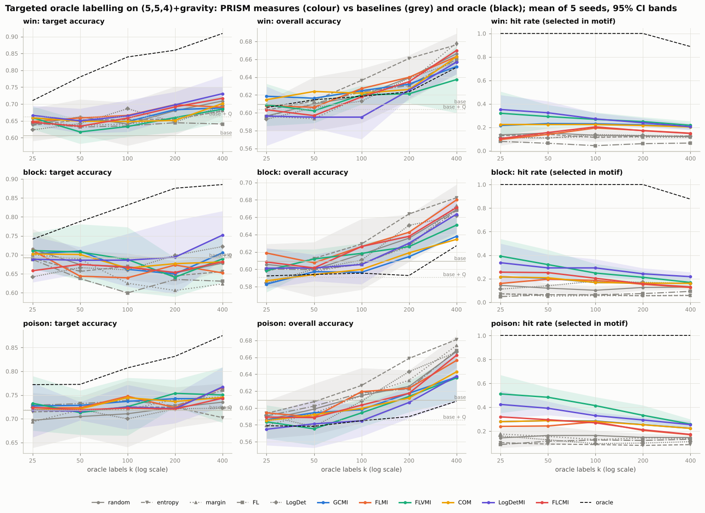
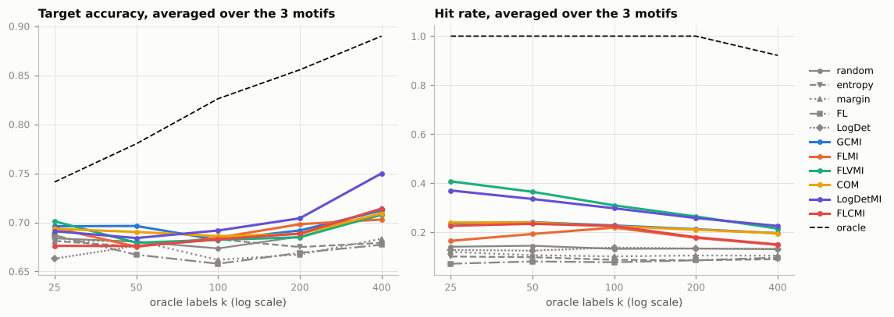
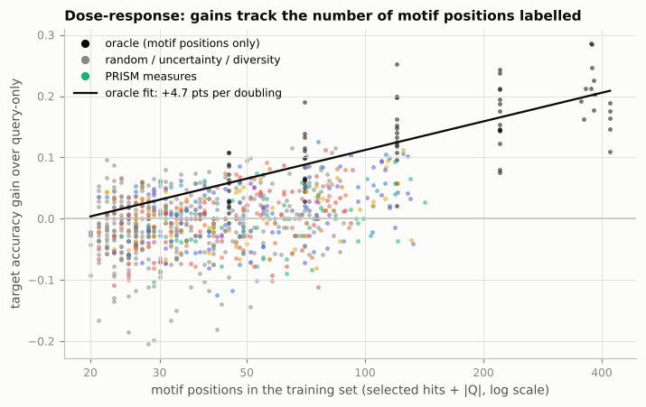
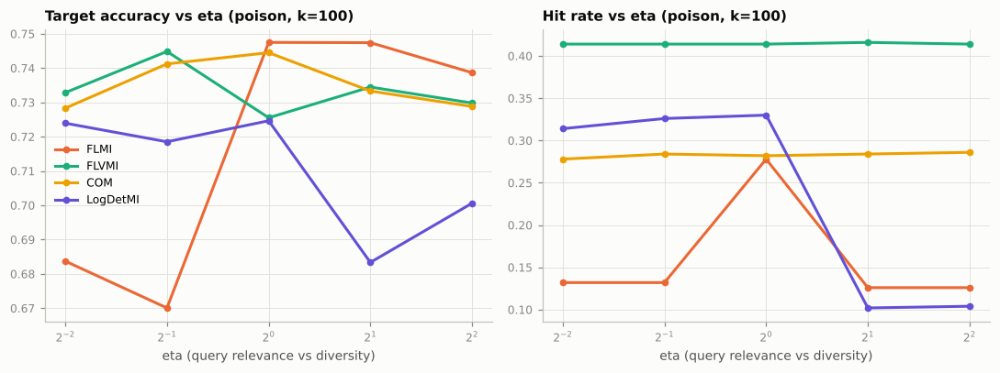
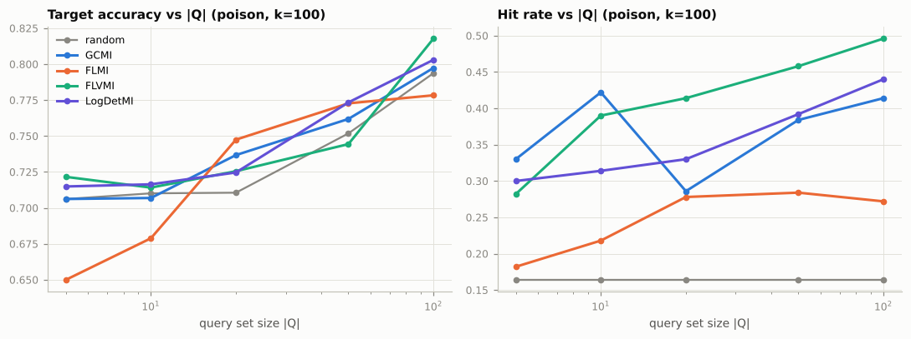

# Fixing a game network's blind spots with a few oracle labels: PRISM-style targeted selection

*A study run inside mnk-bench. Code: [`src/mnkbench/submodular.py`](../../src/mnkbench/submodular.py), [`src/mnkbench/experiments/targeted.py`](../../src/mnkbench/experiments/targeted.py). Data and plots: [`docs/results/targeted/`](../results/targeted/). Reproduce with `mnk-bench experiment targeted --out results` (needs PyTorch; about 1 hour on 4 cores).*

**Abstract.** We transfer PRISM's targeted learning to game-playing networks. A small AlphaZero-style network on mini Connect Four misses three tactical motifs (immediate wins, forced blocks, poisoned moves), each about 12–14% of positions. Given 20 examples of a motif, we choose *k* positions from an unlabelled pool for an exact solver to label, and fine-tune on them. Across 5 seeds × 3 motifs × 5 budgets (25–400 labels), the six PRISM measures do what they are designed to do: they select **2–3× more motif positions than random** (FLVMI: 41% vs 14% at *k* = 25). That enrichment, however, **mostly does not turn into accuracy on the motif**. Only LogDetMI beats random selection reliably: +1.8 points over all budgets (46 of 70 non-tied paired comparisons; sign test p = 0.012, 0.12 after Bonferroni over 10 methods) and +4.3 ± 2.3 points at *k* = 400. The others are within ±1 point of random. Meanwhile an oracle that labels only true motif positions gains +13.3 points (+18.3 at *k* = 400). A dose-response analysis explains the gap. Every method's gain is predicted by the *number* of motif positions it got labelled, at about +4.7 points per doubling. PRISM-selected and randomly selected motif positions are worth the same, and with a 15–40% hit rate the non-motif labels dilute training. Targeting also costs overall accuracy (−1.0 to −1.3 points for GCMI, FLVMI and LogDetMI), where plain uncertainty sampling is best (+1.3 points). The bottleneck is precision, which depends on how well the network's own embeddings separate the motif, not on the choice of submodular objective.

## 1. Motivation

The rest of mnk-bench asks *where each method breaks* as the board grows. Exact search breaks first (minimax is refused from (5,5,4)), but an exact or very deep search is still the best *teacher* available: it can tell a learned agent the right move in any position it is shown. The catch is cost. Each label is a solver call, so in practice only a small budget of positions can be labelled.

That raises a practical question. Suppose you notice your network has a specific blind spot, such as missing immediate wins, and you can collect a handful of positions that show it. **Which positions should you spend the labelling budget on?** This is the *targeted learning* problem that PRISM (Kothawade, Kaushal, Ramakrishnan, Bilmes and Iyer, AAAI 2022) studies for image classifiers. A model underperforms on a rare class, a few examples of that class form a *query set*, and a submodular mutual-information function between candidate subsets and the query set chooses which unlabelled examples to label. This document transfers that setting to games.

## 2. Background: submodular information measures

A set function *f* over a ground set *V* is submodular if marginal gains diminish: *f(A ∪ {j}) − f(A) ≥ f(B ∪ {j}) − f(B)* for *A ⊆ B*. Greedy maximisation of a monotone submodular *f* under a cardinality budget is within (1 − 1/e) of optimal. All functions below use a non-negative similarity kernel *S* (here: cosine similarity of network embeddings).

PRISM builds information measures from a submodular *f*. Given a query set *Q* (what we want) and a private set *P* (what we want to avoid), it defines:

- *submodular mutual information*: *I_f(A; Q) = f(A) + f(Q) − f(A ∪ Q)*;
- *conditional gain*: *f(A | P) = f(A ∪ P) − f(P)*;
- *conditional mutual information*: *I_f(A; Q | P)*.

Instantiated with standard functions, they give the selection objectives compared here (formulas as in the authors' SUBMODLIB implementation):

| name | objective | behaviour |
|---|---|---|
| FL (facility location) | Σᵢ∈V maxⱼ∈A Sᵢⱼ | representation/diversity, ignores Q |
| LogDet | log det(S_A + λI) | diversity (DPP-like), ignores Q |
| **GCMI** | 2λ Σⱼ∈A Σ_q∈Q S_jq | pure query relevance (modular) |
| **FLMI** | Σᵢ∈V min(maxⱼ∈A Sᵢⱼ, η max_q∈Q Sᵢ_q) | query coverage + diversity; saturates |
| **FLVMI** | Σ_q∈Q maxⱼ∈A S_qj + η Σⱼ∈A max_q S_jq | relevance + query coverage, no saturation |
| **COM** | η Σⱼ∈A ψ(Σ_q S_jq) + Σ_q ψ(Σⱼ∈A S_jq), ψ = √ | between GCMI and FLMI |
| **LogDetMI** | log det(S_A) − log det(S_A − η² S_AQ S_Q⁻¹ S_AQᵀ) | relevance + diversity |
| **FLCMI** | Σᵢ max(min(maxⱼ∈A Sᵢⱼ, η max_q Sᵢ_q) − ν max_p Sᵢ_p, 0) | like Q, unlike P |

*η* trades query relevance against diversity, and *ν* sets how strongly *P* is avoided. The implementation (`mnkbench.submodular`) provides each function's direct definition, vectorised marginal gains, plain greedy and Minoux's lazy greedy (exact for submodular functions, and 25–70× faster here). Tests check incremental gains against the definitions, check diminishing returns and monotonicity on random instances, and check greedy against brute force for the (1 − 1/e) bound.

## 3. Setup

**Game.** Mini Connect Four: the (5,5,4) game with gravity. It is small enough that the exact solver labels a position in about 20 ms, and tactical enough to produce clear failure modes.

**The network with blind spots.** An AlphaZero-style policy/value network (the project's 39k-parameter residual CNN) trained by self-play for only 4 iterations × 30 games (about 20 s). Without search, its top policy move keeps the game-theoretic outcome in about 60% of the positions where the choice matters ("decision positions").

**Target weaknesses (the "rare classes").** Positions are grouped by tactical motif, detected exactly from the rules:

| motif | definition | share of positions | base network's blunder rate there |
|---|---|---:|---:|
| `win` | the side to move can win immediately | 11.8% | 39% |
| `block` | the opponent threatens to win next move; it must be blocked | 11.7% | 31% |
| `poison` | some legal move lets the opponent win at once (in gravity games: playing directly below the opponent's threat cell) | 14.2% | 28% |

(Means over the 5 seeds' pools and test sets; blunder rate = share of held-out decision positions of that motif where the network's top move changes the outcome.)

Selection methods never see these motif labels for the pool. They only see network embeddings and the query examples. The motif labels are used solely for evaluation and for the oracle reference.

**Data.** For each seed, positions are sampled from games between a mix of agents (random, rule-based, MCTS-100 and alpha-beta depth 2, with 15% random moves), at most three per game, de-duplicated up to symmetry. They are split into an unlabelled **pool** (3,000), a **development set** (1,000) from which the query set *Q* (20 positions of the target motif) and the private set *P* (20 motif-free positions) are drawn, and a **test set** (2,000).

**Oracle labels.** For a selected position the exact solver returns every *outcome-preserving* move (a win stays a win, a draw stays a draw) and the solved value.

**Selection.** Embeddings are the residual tower's output (flattened, 800-d, non-negative ReLU features), with cosine similarity as the kernel. Methods:

- baselines: random; uncertainty (max policy entropy; min top-2 margin); diversity (FL, LogDet);
- PRISM mutual information with *Q*: GCMI, FLMI, FLVMI, COM, LogDetMI (η = 1);
- PRISM conditional mutual information with *Q* and *P*: FLCMI (η = ν = 1);
- **oracle** reference: random positions *of the target motif* (it uses the hidden labels, so it bounds what perfect targeting could achieve with random choice inside the class).

Greedy selection is nested, so one greedy run at the largest budget gives every smaller budget as a prefix.

**Fine-tuning.** Each method's *k* selected positions, plus the 20 labelled query positions (the same for every method), fine-tune a copy of the network. The training budget is identical for every method: 300 Adam steps, batch 64, learning rate 1e-3, mirror augmentation. The policy target is uniform over the outcome-preserving moves and is applied only to decision positions: where every move keeps the outcome, the oracle says nothing about which to prefer. The value target is the solved outcome. A distillation term on unlabelled pool positions keeps the policy close to the original elsewhere.

**Metrics.** These are raw-policy accuracy (does the top move preserve the outcome?) on held-out *decision positions of the target motif* (**target accuracy**) and on *all* held-out decision positions (**overall accuracy**), plus the share of selected positions that belong to the motif (**hit rate**, PRISM's "how many rare-class examples were selected"). For *k* = 200 the fine-tuned networks also play 20 games each against perfect play and against depth-2 alpha-beta, without search, starting from 20 shared random 4-move openings.

**Protocol.** 5 seeds (fresh data, queries and training seeds; the base network is fixed) × 3 motifs × 12 methods × budgets k ∈ {25, 50, 100, 200, 400}. The ablations at k = 100 on the `poison` motif cover η ∈ {¼, ½, 1, 2, 4}, |Q| ∈ {5, 10, 20, 50, 100}, and raw-board features instead of network features. Means are reported with 95% confidence intervals over seeds, and paired comparisons against random use the same seed and data.

## 4. Results

All numbers are means over 5 seeds × 3 motifs unless stated otherwise. Raw per-run rows are in `docs/results/targeted/targeted_runs.csv` and the statistics in `targeted_significance.csv`.

### 4.1 Selection: PRISM finds the motif



Hit rate (share of selected positions in the target motif; random ≈ base rate ≈ 13%):

| method | k = 25 | k = 100 | k = 400 |
|---|---:|---:|---:|
| random | 0.14 | 0.13 | 0.13 |
| entropy / margin | 0.10 / 0.12 | 0.09 / 0.10 | 0.09 / 0.11 |
| FL / LogDet (diversity only) | 0.07 / 0.13 | 0.08 / 0.14 | 0.10 / 0.13 |
| GCMI | 0.24 | 0.23 | 0.20 |
| FLMI | 0.17 | 0.22 | 0.15 |
| **FLVMI** | **0.41** | **0.31** | 0.22 |
| COM | 0.24 | 0.23 | 0.20 |
| **LogDetMI** | 0.37 | 0.30 | **0.23** |
| FLCMI | 0.23 | 0.23 | 0.15 |
| oracle | 1.00 | 1.00 | 0.92 |

Every query-guided measure enriches the selection, most at small budgets, as PRISM's theory predicts: once the most query-like positions are taken, the remaining ones are less similar. FLVMI and LogDetMI, which combine relevance with query coverage, enrich most. FLMI's saturation shows here: it stops valuing query-relevant points once the query is "covered". Pure diversity (FL) *under*-samples the motif, because motif positions are a small region of embedding space and a representative subset avoids over-covering it. Uncertainty sampling also under-samples it: the network is not especially uncertain in positions where it blunders.

### 4.2 Learning: little transfers, except for LogDetMI at larger budgets

Target accuracy, averaged over the three motifs (base network 0.672; base + the 20 labelled query positions 0.691):

| method | k = 25 | k = 100 | k = 400 | vs random, all budgets (wins/losses, mean ± 95% CI) |
|---|---:|---:|---:|---|
| random | 0.684 | 0.673 | 0.707 | — |
| entropy | 0.681 | 0.683 | 0.679 | 36/35, −0.7 ± 1.2 |
| margin | 0.681 | 0.662 | 0.683 | 28/42, −1.1 ± 1.2 |
| FL | 0.687 | 0.658 | 0.677 | 31/41, −1.4 ± 1.5 |
| LogDet | 0.663 | 0.682 | 0.713 | 32/41, −0.1 ± 1.3 |
| GCMI | 0.696 | 0.682 | 0.712 | 39/30, +1.0 ± 1.2 |
| FLMI | 0.694 | 0.684 | 0.703 | 38/31, +0.5 ± 1.2 |
| FLVMI | **0.701** | 0.682 | 0.708 | 34/34, +0.5 ± 1.1 |
| COM | 0.693 | 0.686 | 0.709 | 34/32, +0.7 ± 1.0 |
| **LogDetMI** | 0.691 | **0.692** | **0.750** | **46/24, +1.8 ± 1.1** (p = 0.012; Bonferroni 0.12) |
| FLCMI | 0.676 | 0.683 | 0.714 | 35/36, +0.1 ± 1.1 |
| oracle | 0.741 | 0.826 | 0.890 | 72/1, +13.3 ± 1.6 |

At *k* = 400, LogDetMI beats random in 11 of 13 non-tied comparisons (+4.3 ± 2.3 points, p = 0.022 uncorrected). It is also the only method whose curve clearly separates from random in all three motifs at the largest budget (win 0.731 vs 0.709, block 0.752 vs 0.678, poison 0.767 vs 0.735). We read this as a real but modest effect: consistent in direction, significant before multiple-comparison correction, not after.



### 4.3 Why enrichment doesn't become accuracy: dose-response



For each run we plot the target-accuracy gain over the query-only network against the number of motif positions in its training set (hit rate × *k* + 20). The oracle's runs (pure motif data) lie on a clean log-linear curve: **+4.7 points per doubling** of labelled motif positions. Every other method, PRISM or baseline, sits about **5 points below that curve on average**: random −5.0, GCMI −5.5, FLMI −5.3, LogDetMI −5.6, FLVMI −6.9. Two conclusions follow:

1. **A motif position selected by a PRISM measure is worth no more than a random motif position.** The selection adds quantity, not quality. FLVMI is slightly *below* random. Its picks are the positions most similar to the query examples, which are partly redundant with the query positions already in the training set.
2. **The non-motif labels cost something.** With a fixed training budget, gradient steps spent on the 60–85% of selected positions that are not in the motif dilute the targeted signal. This is why a 2–3× enrichment buys so little: going from 14% to 41% hits at *k* = 25 means about 10 instead of 3.5 extra motif positions on top of the 20 query positions, which is a fraction of one doubling.

### 4.4 Targeting costs overall accuracy

Overall accuracy over all decision positions, paired against random over all budgets:

| method | wins/losses | mean ± 95% CI | p (sign) |
|---|---|---|---|
| **entropy** | 54/19 | **+1.3 ± 0.5** | 5e-5 |
| FLMI | 41/32 | +0.3 ± 0.5 | 0.35 |
| GCMI | 25/50 | −1.0 ± 0.6 | 0.005 |
| FLVMI | 26/49 | −1.0 ± 0.6 | 0.011 |
| LogDetMI | 22/52 | −1.3 ± 0.6 | 6e-4 |
| oracle | 19/54 | −2.0 ± 0.6 | 5e-5 |

This is the expected trade-off: labels spent on one motif are not spent on the network's other mistakes. Uncertainty sampling, which does not target anything, is the best general-purpose strategy. FLMI, the most diversity-preserving MI measure, is the only targeted method that does not pay this cost.

### 4.5 Ablations (`poison` motif, k = 100)



- **η (relevance vs diversity).** FLVMI and COM are flat across η ∈ [¼, 4] (FLVMI's hit rate stays at 0.41). FLMI needs η ≥ 1: below that the cap η·max S_iQ saturates immediately, and its hit rate falls from 0.28 to 0.13. LogDetMI is best at η ≤ 1 (hit 0.31–0.33) and collapses at η ≥ 2 (0.10). There, the conditional kernel S − η² S_VQ S_Q⁻¹ S_QV loses positive definiteness and has to be regularised, which washes out the query term. **η = 1 is a safe default for every measure.**
- **|Q| (number of known examples).** More query examples help everyone, but mostly because they are also *labelled training data*: random selection goes from 0.706 to 0.794 as |Q| goes from 5 to 100. Enrichment improves too (FLVMI hit rate 0.28 → 0.50), and at |Q| = 100 FLVMI reaches 0.818 vs 0.794 for random. In practice, collecting more examples of the weakness is at least as valuable as choosing the pool subset cleverly.
- **Similarity features.** Raw board planes instead of network features lower the hit rate of GCMI (0.29 → 0.24), FLVMI (0.41 → 0.38) and LogDetMI (0.33 → 0.28). Accuracy changes stay within noise, except FLMI, which drops from 0.747 to 0.709. Neither representation separates the motifs well. An offline check of other choices (policy distributions, pooled features, BADGE-style gradient embeddings) found none clearly better.



### 4.6 Playing strength

Without search, the fine-tuned networks' non-loss rate against perfect play from 20 random openings is 0.05–0.22 for every method and motif, against 0.17 for the base network. Differences between methods are within game-to-game noise. None of the strategies made the network play worse, and 200 labels are too few to make a measurable difference in full games.

## 5. Discussion

**What transferred from PRISM.** The submodular information measures behave in games as they do on images. They reliably pull a rare, query-defined class out of an unlabelled pool, with the relevance-diversity behaviour the paper describes (GCMI pure relevance, FLMI saturating, FLVMI and LogDetMI balancing both, η controlling the trade-off). LogDetMI was the best measure overall here.

**What did not.** Enrichment from 13% to 30–40% was not enough to fix the weakness. The network's own embedding space, learned in 20 seconds of self-play, does not separate "a win is available" from look-alike positions where it isn't. Because selected motif positions are worth no more than random ones, the method's value comes entirely from its hit rate.

**Implications for mnk-bench.** This adds a new axis to "where does each method break": *how cheaply can a learned agent's weakness be patched with an expensive teacher?* With an exact solver as teacher, the answer on mini Connect Four is about +4.7 points of motif accuracy per doubling of motif labels. Selection precision is the lever. Whether a stronger network's embeddings (where motifs are more linearly separable) would make PRISM selection pay off is the natural next experiment, as is selecting in several rounds, with each round's newly labelled motif positions added to *Q*.

## 6. Limitations

- One game, one network size and one fixed base network. The seeds vary the data, queries and training, not the base network.
- The motifs are detectable by rules, which makes evaluation exact. In practice you would detect them with exactly such rules, which would make selection trivial. The study treats them as stand-ins for weaknesses that *cannot* be described by a rule.
- Fixed training budget (300 steps) for every *k*. A budget that grows with *k* could change the dilution effect.
- Game results use 20 games per network and are underpowered.
- p-values are from sign tests over 75 paired comparisons that share seeds and data across budgets, so they are not fully independent. We report the Bonferroni-corrected values alongside.

## 7. Reproducing

```bash
pip install -e ".[dev,alphazero]"
mnk-bench experiment targeted --out results -v       # ~1 hour on 4 cores
mnk-bench experiment targeted --quick --out /tmp/t   # ~1 minute smoke test
pytest tests/test_submodular.py tests/test_targeted.py
```

The submodular functions can be used on their own:

```python
from mnkbench.submodular import cosine_kernel, make_function, lazy_greedy
S, S_VQ = cosine_kernel(X), cosine_kernel(X, Q)          # X: pool features, Q: query features
picked = lazy_greedy(make_function("FLVMI", S, S_VQ, eta=1.0), k=100)
```

## References

- S. Kothawade, V. Kaushal, G. Ramakrishnan, J. Bilmes, R. Iyer. *PRISM: A Rich Class of Parameterized Submodular Information Measures for Guided Subset Selection.* AAAI 2022. arXiv:2103.00128.
- V. Kaushal et al. *SUBMODLIB: A Submodular Optimization Library* (the authors' implementation; formula reference for the measures used here, since the paper itself could not be retrieved from this environment).
- M. Minoux. *Accelerated greedy algorithms for maximizing submodular set functions.* 1978.
- L. Chen, G. Zhang, H. Zhou. *Fast greedy MAP inference for determinantal point processes.* NeurIPS 2018.
- G. L. Nemhauser, L. A. Wolsey, M. L. Fisher. *An analysis of approximations for maximizing submodular set functions.* 1978.

